# AKD1500 Lab

Reproducible native-learning checks, matched CPU benchmarks, mesh-resource
probes, and external power-recorder tools for BrainChip's AKD1500.

This is an independent research toolkit. It measures what a mapped program
actually does and preserves the distinction between mapping, correct execution,
performance, and electrical energy. It does not establish a neuromorphic
advantage by assuming one.

## Correct the teacher, revise the native network — October 25, 2026 (UTC)

**Changed source knowledge now revises separate native student memories repeatedly.**
Across three initializations and twelve reversals: **3,456/3,456** post-transfer
queries with the teacher answer path silent. Trained students frozen after the
common prefix, the teaching link cut after that prefix, and source retirement
removed each score **2,592/3,456**. CPU teacher/student dictionaries also pass3,456/3,456.

The source receives external positive/complement evidence. Student transfer still
uses constant class0, no host-provided outcome and no host decode of the teacher.
Native source predictions drive the feature code; native competition and connection
updates revise the students. Twelve complete unrelated original record payloads
remain unchanged. This is a four-cue synthetic study with designed coding and clocks,
not general memory management, autonomous truth checking or an efficiency advantage.

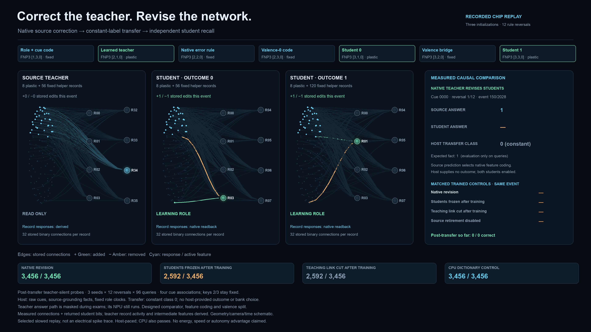

[1080p60 replay](https://raw.githubusercontent.com/MidasMulli/akd1500-lab/main/visual/native-memory-revision-1080p60.mp4) ·
[assessment and all online queries](studies/20261025-transfer-revision/ASSESSMENT.md) ·
[protocol](studies/20261025-transfer-revision/PROTOCOL.md) ·
[numeric audit](results/20261025-transfer-revision.audit.json)

Before transfer, native students still give the old answers (**288/576** exams);
after transfer they correct them. All online queries, including acquisition,
score **4,560/5,280**, as do the CPU dictionaries. Controls start with the same
learned RAM prefix; source trajectories remain identical under the cut/frozen
student controls. Sixteen physical cells/25,408 forwards; no execution failures.

```sh
python -m admission.revision_archive audit
python -m admission.revision_mutations
```

## A learned memory teaches another — October 25, 2026 (UTC)

**A native learned source transfers associations into separate native memories;
those students later answer with the source answer path silent.** Three initializations:
**288/288** final six-key queries, versus **0/288** with the native teaching link cut
and **0/288** with student learning disabled. The source's complete RAM trajectory
stays identical across the controls. Strong CPU dictionaries also pass288/288.

External outcomes ground the source only. Every student-transfer descriptor has
constant class0, with no external outcome bytes or host prediction decode. Native
source predictions drive the designed error/valence coding; native competition
selects records and updates connections. The teacher-silent exam masks source
plastic cues while its fixed key-routing helpers still run; it is not power gating.
Seven sequential FNP3s,24 plastic records, host-paced roles. No efficiency claim.

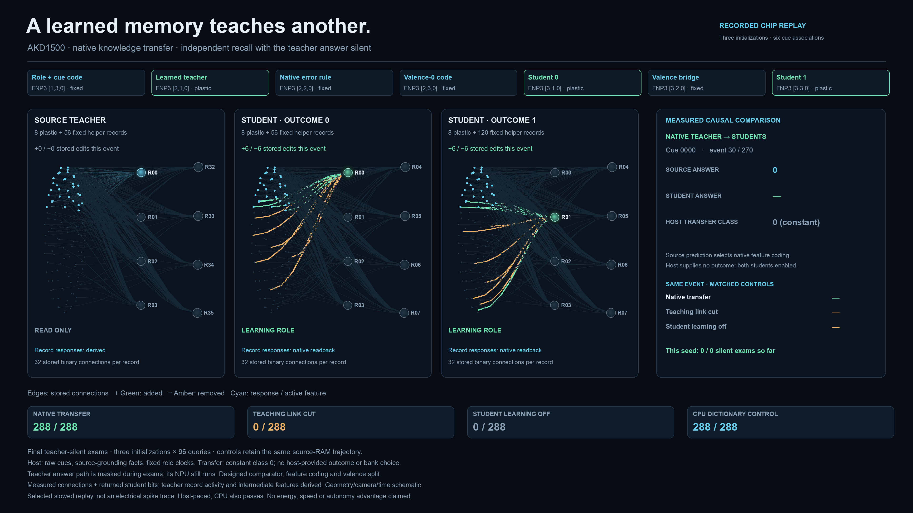

[1080p60 recorded replay](https://raw.githubusercontent.com/MidasMulli/akd1500-lab/main/visual/native-teacher-transfer-1080p60.mp4) ·
[full assessment and preserved failures](studies/20261025-native-transfer/ASSESSMENT.md) ·
[protocol](studies/20261025-native-transfer/PROTOCOL.md) ·
[numeric audit](results/20261025-native-transfer.audit.json)

Adding new facts makes two source initializations forget one older association;
students retain the original facts and add the new ones. This qualifies engineered
native transfer and independent storage, not protection against arbitrary wrong
teachers, discovery of truth from nothing, autonomous scheduling or a CPU advantage.
Twelve qualified physical cells/2,754 forwards; the separate62-forward failed actor
prefix and four compiler/authoring failures remain preserved. Eight corruptions fail.

```sh
python -m admission.transfer_archive audit
python -m admission.transfer_mutations
```

## Resident memories adapt independently — October 25, 2026 (UTC)

**Two co-resident native banks correct opposite answers to the same cue IDs,
without cross-context RAM changes.** Both banks stay enabled on every teacher clock;
native feature routing selects which receives a matching learning input. Across
three initializations plus three first-seed order replications, read-only correction
passes **6,912/6,912**, versus **4,368/6,912** without retirement and **5,184/6,912**
trained-frozen. CPU dictionary/LRU also pass6,912/6,912 and acquire slightly better.

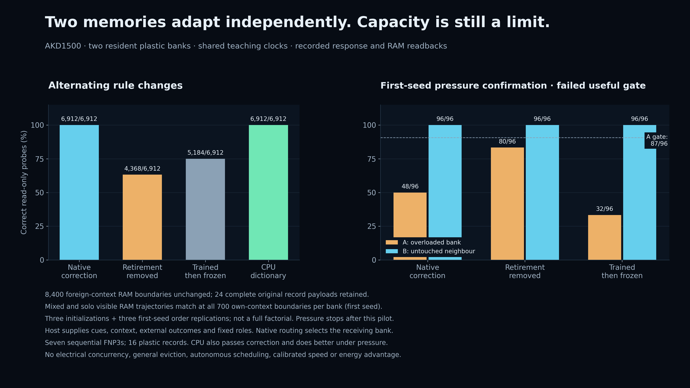

All8,400 foreign-context boundaries stay byte-identical. First-seed solo and mixed
RAM trajectories match at all700 own-context boundaries per bank. **Pressure still
fails:** the overloaded bank scores48/96 while its untouched neighbour remains96/96;
removing retirement improves the overloaded bank to80/96. No expansion after that
negative. Isolation is qualified; general useful eviction remains open.

[Assessment](studies/20261025-isolated-correction/ASSESSMENT.md) ·
[protocol](studies/20261025-isolated-correction/PROTOCOL.md) ·
[numeric audit](results/20261025-isolated-correction.audit.json)

```sh
python -m admission.isolation_archive audit
python -m admission.isolation_mutations
```

## Correct changing memories without resetting the bank — October 25, 2026 (UTC)

**A native prediction-error gate and contradictory teaching let the AKD1500 retire
obsolete responses and reuse its eight-record memory while two unrelated memories
stay unchanged.** Twelve alternating reversals across three initializations:
1,728/1,728 read-only probes, versus 1,001/1,728 without the retirement path and
1,299/1,728 trained-then-frozen. The CPU dictionary also passes 1,728/1,728 and
slightly outperforms native acquisition; no energy or speed advantage is claimed.

The host supplies raw keys, external outcomes and fixed teaching roles. Native
comparison selects when teaching reaches the binary learner; native competition
selects the record and changes its connections. No host weight repair, threshold
reset or program reload within a session. Shared coding and the retirement rule
are engineered. Five sequential FNP3s, one plastic bank—not a whole-chip test.

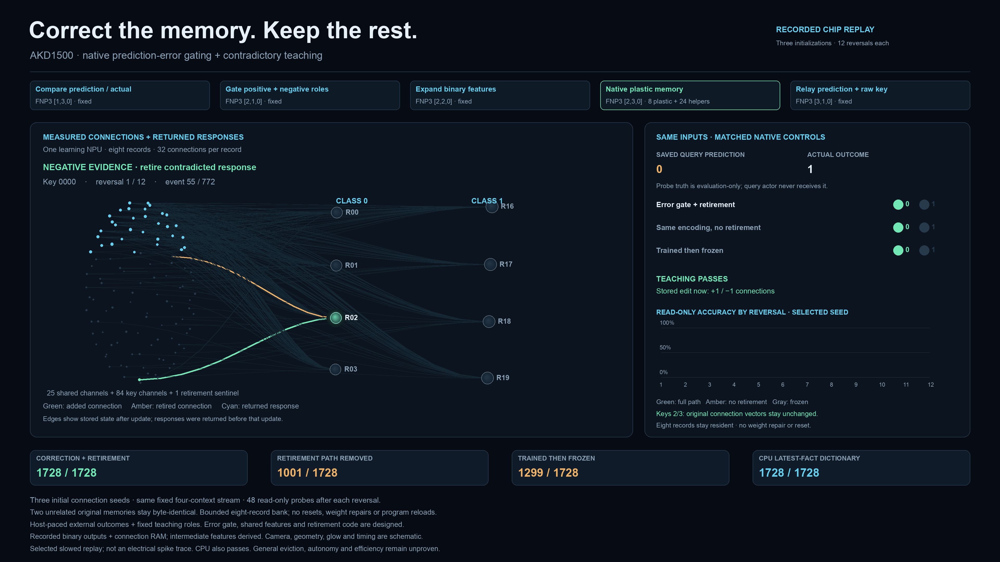

[1080p60 recorded replay](https://raw.githubusercontent.com/MidasMulli/akd1500-lab/main/visual/native-memory-correction-1080p60.mp4) ·
[4K60 master](https://raw.githubusercontent.com/MidasMulli/akd1500-lab/main/visual/native-memory-correction-4k60.mp4)

The earlier error-only version **failed** reversal and capacity. Those results
remain in the archive; this revision does not solve general importance-aware
memory eviction. [Full assessment and limits](studies/20261025-native-correction/ASSESSMENT.md) ·
[protocol](studies/20261025-native-correction/PROTOCOL.md) ·
[numeric audit](results/20261025-native-correction.audit.json)

```sh
python -m admission.correction_archive audit
python -m admission.correction_mutations
```

## Learning controls learning — October 25, 2026 (UTC)

**A native plastic manager controls what another native bank is allowed to learn.**
Seven sequential FNP3s hold three plastic groups. The manager stores the latest raw
key in its connections; its pre-update match travels through a native output buffer
and gates teaching of a protected consequence bank. Nano supplies raw observations,
uniform phase clocks and delayed actual outcomes, with no data-dependent host
bank/record choice. The fixed per-bank clock schedule remains host-controlled.

Across five initializations, useful-memory revisit passes **120/120** and held-out
ordering **480/480**. Always-open yields **170/480**, trained-frozen **150/480**.
Freezing the manager or severing its permission each reduces the first-seed result
from **96/96 to30/96**, while the severed arm retains the exact manager-RAM trajectory.
All10 original record IDs/weights survive. The benefit is keeping free capacity
for later useful inputs; old records also survive in the open control.

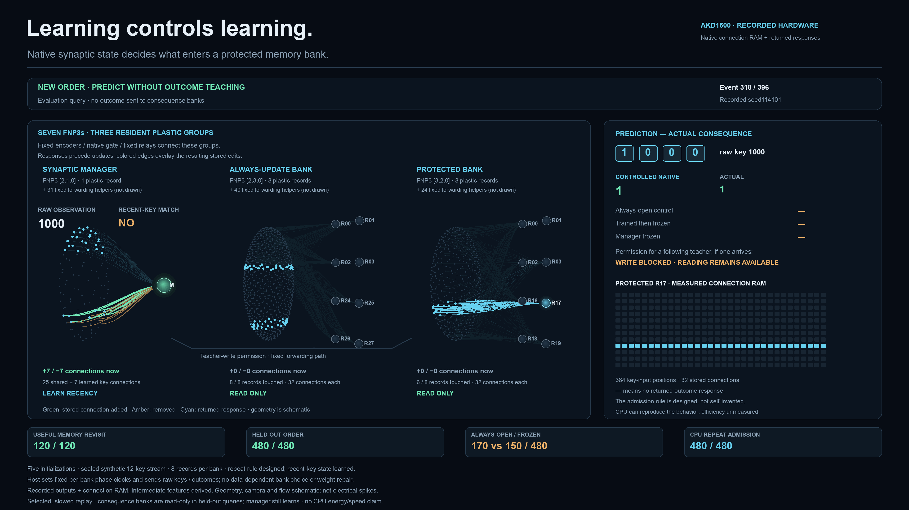

[1080p60 MP4](https://raw.githubusercontent.com/MidasMulli/akd1500-lab/main/visual/learning-controls-learning-1080p60.mp4) ·
[4K60 MP4](https://raw.githubusercontent.com/MidasMulli/akd1500-lab/main/visual/learning-controls-learning-4k60.mp4) ·
[public tools and audit](admission/README.md) ·
[full results, CPU controls and limitations](studies/20261025-learned-admission/ASSESSMENT.md)

The repeat rule and representation are designed; recent-key state and consequence
associations learn natively. The CPU repeat-admission control also passes480/480,
and CPU controls do better on cold/mixed-stream queries. No speed/energy advantage
or self-invented management objective is claimed. This extends the stock final-
classifier workflow with qualified resident coordination of three plastic banks.
All7,780 final-series forwards replay; the separate fixed-policy prerequisite's
1,048 forwards and preserved failures remain distinct. Nine rehashed corruptions fail.

```sh
python -m admission.archive audit
python -m admission.mutations
```

The next [software-only relevance screen](studies/20261025-admission-relevance/ASSESSMENT.md)
challenges the designed repetition rule with repeated distractions and spaced
future-query inputs. It reproduces the qualified original result, then exposes
admission/reclamation gaps. It adds no physical sessions or efficiency claims.

## Native context-record allocation — October 24, 2026

**The chip chooses which record to learn and which learned record responds.**
Thirty-two initially random plastic records share one constant training class;
no context-ID label or host-selected memory enters the acting path. Three NPUs
carry raw history, compute a fixed feature basis and learn distinct record responses.
Across five initializations: **80/80** history allocations, **20/20** original record
IDs retained, and **640/640** windows recalled in a new untrained ordering.
The trained-frozen bank retains its four known histories per seed (**20/80** total).

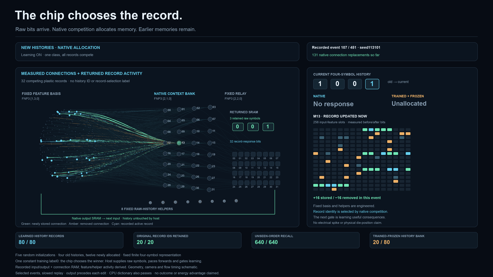

[1080p60 MP4](https://raw.githubusercontent.com/MidasMulli/akd1500-lab/main/visual/context-discovery-1080p60.mp4) ·
[4K60 MP4](https://raw.githubusercontent.com/MidasMulli/akd1500-lab/main/visual/context-discovery-4k60.mp4) ·
[tooling and portable audit](discovery/README.md) ·
[assessment, controls and failures](studies/20261024-context-discovery/ASSESSMENT.md)

The history representation and shift mechanism are engineered; record identities
are learned. Host-paced forwards and explicit query learning-disable remain. Strong
CPU dictionary also succeeds. This qualifies memory allocation/selection, **not yet
consequence prediction, an autonomous useful loop, or an efficiency advantage**.
All8,379 qualified forwards replay; two early failed hardware prefixes and two
compiler failures remain preserved. Single-class learning is a documented primitive.

```sh
python -m discovery.archive audit
python -m discovery.audit_mutations
```

## The same external symbol, different native answers — October 24, 2026

**The preceding chip output supplies context for the next prediction.** A current-only
external X produces four different answers according to prior context retained in
device SRAM. The host writes only the current-symbol half of the native output buffer;
the next descriptor reads the retained history directly. Fresh external labels change
two associations repeatedly without reloading weights or resetting thresholds.

Across five initializations and eight changes between two synthetic rules, post-teaching
predictions pass **480/480**, versus **360/480** for frozen and unlabelled controls.
Erasing only carried history removes all **480** X responses while captured learning
RAM stays identical to the intact arm at every probe. Ordinary context responses survive.
Incomplete cues after 1 ms and 20 ms pauses also pass.

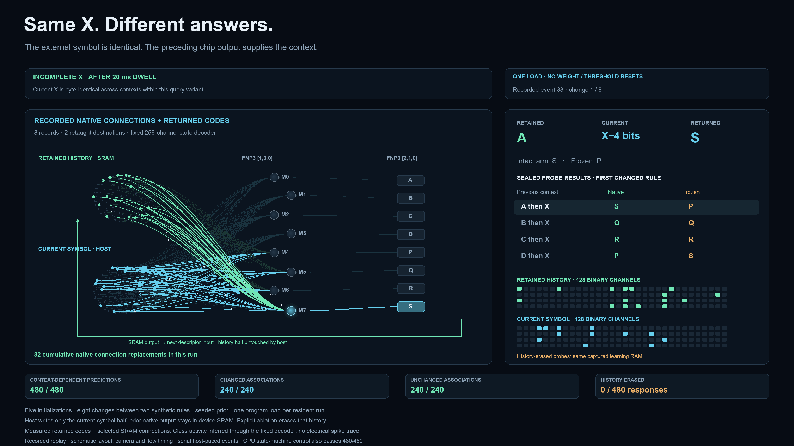

[1080p60 MP4](https://raw.githubusercontent.com/MidasMulli/akd1500-lab/main/visual/temporal-context-1080p60.mp4) ·
[4K60 MP4](https://raw.githubusercontent.com/MidasMulli/akd1500-lab/main/visual/temporal-context-4k60.mp4) ·
[tools and audit](temporal/README.md) ·
[assessment](studies/20261024-temporal-context/ASSESSMENT.md)

The strong CPU state-machine control also passes **480/480**. This is an engineered,
two-NPU, host-paced context experiment with external teaching, not discovery of a
sequence representation, indefinite autonomy or a CPU/energy advantage. It qualifies
explicit context in output SRAM, separately from the earlier query-history effect
outside the captured learning bank. All **5,400** forwards and learning-bank boundaries
independently replay.

```sh
python -m temporal.archive audit
python -m temporal.audit_mutations
```

## Repeated adaptation in one resident network — October 24, 2026

**Fresh external observations change native memory, and chip-fed predictions continue
from the last output kept in device SRAM.** Across five initializations and twelve
changes per resident run, changed-rule checks pass **120/120**, unchanged associations
**360/360**, and post-update feedback consistency **960/960**. The inherited setting
learns the first change but blocks later reversals; a fixed SDK competition setting
permits continued native updates without reloading weights or resetting thresholds.

Two NPUs, eight learning records and two alternating synthetic maps. The host pauses
feedback to insert externally labelled examples and probes. These are finite,
host-paced sessions. The CPU task control also passes; no speed or energy advantage
is established. Counts are repeated checks across five initializations, not independent
trials or 120 distinct facts.

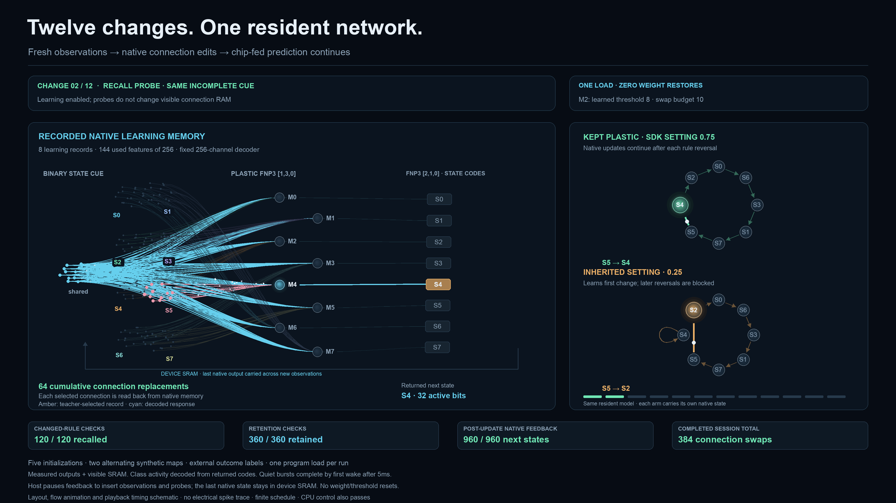

[1080p60 MP4](https://raw.githubusercontent.com/MidasMulli/akd1500-lab/main/visual/resident-adaptation-1080p60.mp4) ·
[4K60 MP4](https://raw.githubusercontent.com/MidasMulli/akd1500-lab/main/visual/resident-adaptation-4k60.mp4) ·
[tools and audit](plasticity/README.md) ·
[assessment and preserved failure](studies/20261024-resident-adaptation/ASSESSMENT.md)

A separate one-initialization control finds that input-dependent query history changes
a later native edit despite identical captured learning RAM. Eight incomplete cues
change six subsequent mask bits; eight full cues with the same returned codes and
descriptor count do not. The incomplete-cue case repeats exactly. No hidden register
was directly read. [Recorded selector comparison](visual/resident-adaptation-selector-4k.png).

```sh
python -m plasticity.archive audit
python -m plasticity.audit_mutations
```

## Learning changes the native trajectory — October 24, 2026

**Native connection changes now alter the sequence followed by chip-fed feedback.**
Across five initializations, externally taught transition changes are recalled
**10/10**, unchanged associations retained **30/30**, and subsequent predictions
match the new graphs **1,280/1,280**, versus **309/1,280** for each frozen and
unlabelled control. All returned outputs and captured visible SRAM states replay.

Two FNP3s, eight class-addressed learning records, an engineered prior and one
externally taught change episode. The 32-step schedule is finite. The CPU task
control also succeeds; no speed or energy advantage is established. A separate
two-pass hardware-generated replay test fails during configuration, before
inference, and is held. Failed attempts are preserved.

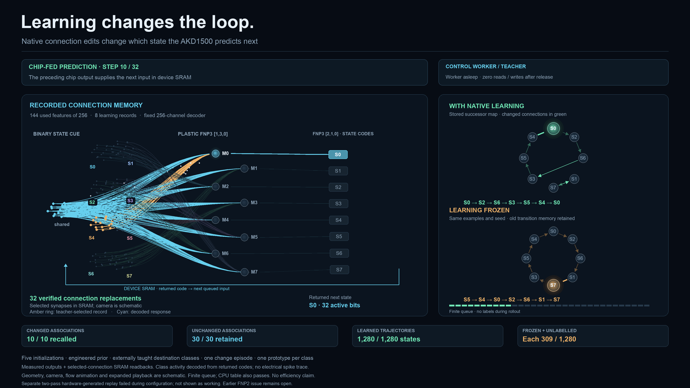

[1080p60 MP4](https://raw.githubusercontent.com/MidasMulli/akd1500-lab/main/visual/learned-transition-1080p60.mp4) ·
[4K60 MP4](https://raw.githubusercontent.com/MidasMulli/akd1500-lab/main/visual/learned-transition-4k60.mp4) ·
[tools and audit](transition/README.md) ·
[assessment and failures](studies/20261024-learned-transition/ASSESSMENT.md)

```sh
python -m transition.archive audit
```

## Bounded native feedback — October 24, 2026

**One seed produces 32 dependent native steps while the Nano control worker sleeps.**
Each queued step reads the preceding output directly from device SRAM. One FNP3
learns; a fixed second FNP3 relays the output. Across three initializations,
native learning makes 64 connection replacements per seed and responds to all
12 later partial-cue queries; frozen learning responds to none. Repeated-seed
and severed-feedback controls each respond to 3/12. Exact CPU replay matches.

The state cycle is programmed and the schedule is finite. It stops when the
prepared jobs are exhausted. This qualifies bounded native feedback and seeded
rehearsal, not indefinite autonomy, external knowledge discovery or efficiency.

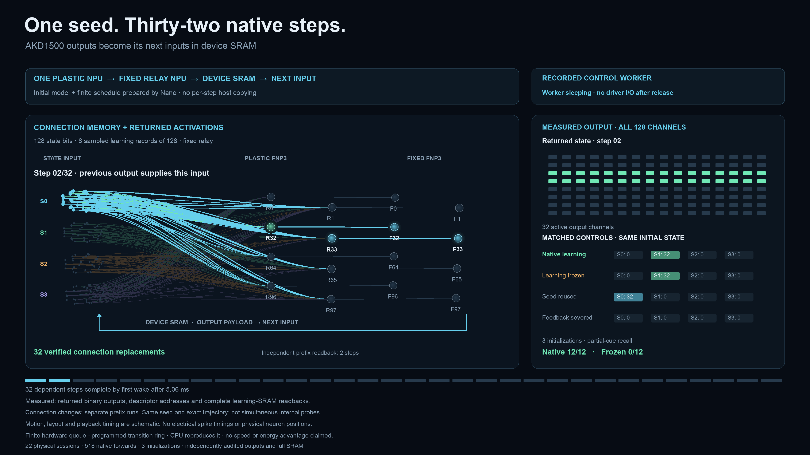

[1080p60 MP4](https://raw.githubusercontent.com/MidasMulli/akd1500-lab/main/visual/native-feedback-1080p60.mp4) ·
[4K60 MP4](https://raw.githubusercontent.com/MidasMulli/akd1500-lab/main/visual/native-feedback-4k60.mp4) ·
[tools and audit](recurrence/README.md) ·
[assessment and boundaries](studies/20261024-native-feedback/ASSESSMENT.md)

```sh
python -m recurrence.archive audit
```

## Input-gated native learning — October 24, 2026

**Prediction queries preserve connection memory while native learning stays enabled.**
A fixed sparse encoding and match threshold let outcome inputs trigger native updates
without per-event host mode/class changes. One FNP3 learns; a second fixed FNP3 reads
out the result. Across three initializations, changed-rule checks pass **6/6** and
unchanged retention **42/42**. Sealed trajectories score **576/576**, versus **511/576**
for trained-then-frozen and disconnected-feedback controls. All contexts were taught.

The CPU remains faster. Twelve paced T202 GPU co-running runs show no reproducible
GPU-service advantage, and the native host path uses more CPU. One late optimized-CPU
batch is retained. This is bounded input-gated learning, not indefinite autonomous
recurrence, internal outcome generation, new-context generalization or an energy win.

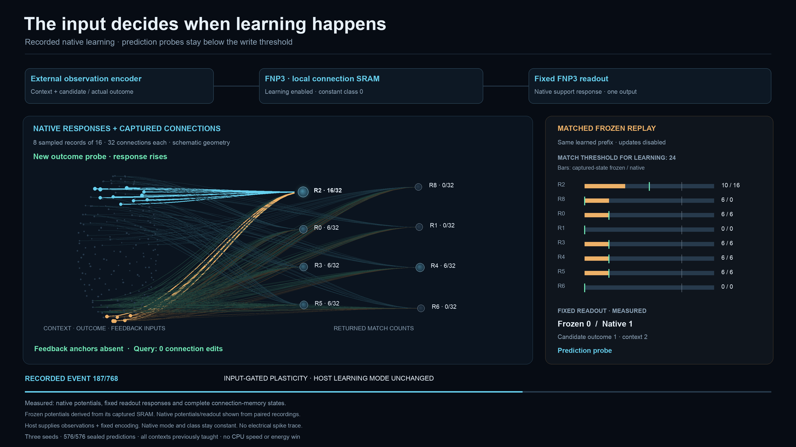

[1080p60 MP4](https://raw.githubusercontent.com/MidasMulli/akd1500-lab/main/visual/input-gated-learning-1080p60.mp4) ·
[4K60 MP4](https://raw.githubusercontent.com/MidasMulli/akd1500-lab/main/visual/input-gated-learning-4k60.mp4) ·
[tools and reproduction](feedback/README.md) ·
[assessment and limitations](studies/20261024-predictive-feedback/ASSESSMENT.md)

```sh
python -m feedback.archive audit
python -m feedback.corun_audit audit
```

## Guarded native learning over a larger model — October 24, 2026

**A native class-window workaround passes; the original direct path stays failed.**
An 11,264-record model remains in Nano host DDR. The host chooses a bounded class
view from the teacher label; the AKD selects the winner and changes connections.
Full-model recall then reads those same records. No CPU weight repair occurs.

Across three initializations, **24 selected single-swap updates** match the full
CPU rule and every captured bank state. Learned recall is32/32 connection matches;
matched frozen recall is31/32. Those are match counts, not task accuracy.
Host writes to the live record bank after initial loading: **zero**.

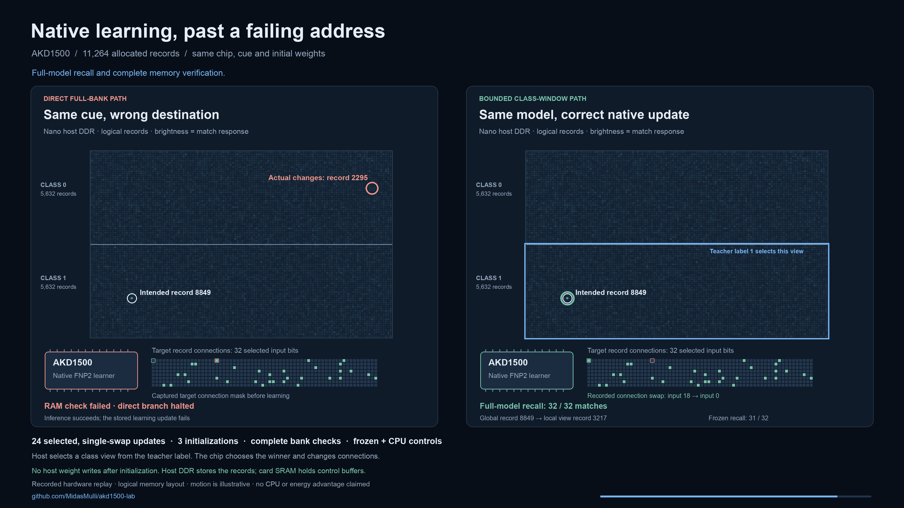

[4K60 MP4](https://raw.githubusercontent.com/MidasMulli/akd1500-lab/main/visual/fnp2-window-4k60.mp4) ·
[1080p60 download](https://raw.githubusercontent.com/MidasMulli/akd1500-lab/main/visual/fnp2-window-1080p60.mp4) ·
[method, failures and limitations](coprocessor/WINDOWS.md) ·
[numeric replay](results/2026-10-24-fnp2-window.json)

This uses one physical FNP2, externally stored records and host scheduling.
It does not qualify all allocated records, arbitrary learning streams, autonomous
operation, a CPU advantage or electrical efficiency. Stock-SDK and record-stride
failures, a contradicted alias hypothesis and invalid placement are preserved.

## FNP2: inference works, high-address learning fails — October 24, 2026

The previously excluded FNP2 format now executes with records in the card's
shared SRAM. Capacity prefixes pass through 8192 records; 11,264-record frozen
inference also passes. **A targeted learning test reveals a separate limit:**
record6500 updates correctly, while a unique record6600 winner changes record46.
The host-write observer records zero host writes to the record buffer.

The metadata change lands at an offset consistent with a 512-KiB alias; the
complete root cause is unresolved. All partial data and both failed prefixes
are preserved. Large inference populations are not qualified learning address
coverage, and this is not a claim of a silicon erratum or CPU advantage.

[Minimal reproducer, controls and limitations](coprocessor/FNP2.md) ·
[Numeric evidence](results/2026-10-24-fnp2-contract.json)

## Documented PCIe environment: RGB to native learning — October 24, 2026

**BrainChip explicitly intends PCIe/M.2 to work beside application processors.**
We reproduced that path on the Nano: raw RGB enters the dedicated image
converter, passes through a 4-bit convolutional layer, and reaches native binary
learning in one resident compiler pass. The host does no intermediate feature
extraction. Every potential and captured learner-state boundary independently
replays across **3,872 native forwards and 1,016 full RAM snapshots**.

This is a seeded hardware characterization, not a trained vision model. CPU
remains faster overall. At the widest fixed workload, optimized CPU NEON takes
248 µs/image with learning; queued mapped AKD takes 447 µs. DMA both ways lowers
caller activity to about 99 µs/image but increases elapsed time to 707 µs.
Calling CPU excludes kernel workers and is not electrical energy. Two failed
compiler/reference attempts and all four transport profiles are preserved.

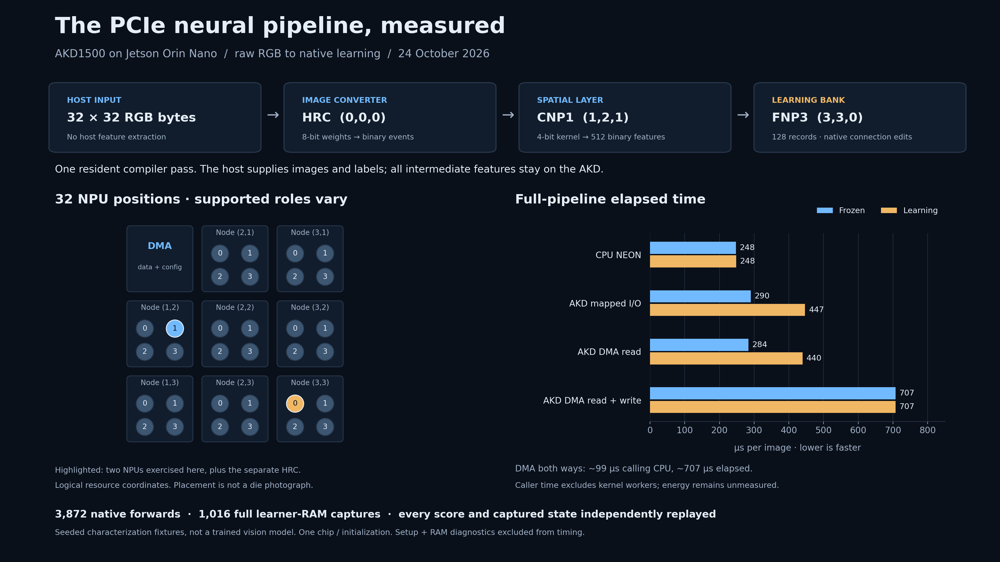

[Environment and reproduction](coprocessor/README.md) ·
[fabric, memory and routing map](coprocessor/FABRIC_MAP.md) ·
[assessment](studies/20261024-pcie-fabric/ASSESSMENT.md) ·
[numeric evidence](results/2026-10-24-pcie-fabric.json)

```bash
python -m coprocessor.archive audit-public
```

## Streaming prediction: native adaptation; skipped inference held — October 24, 2026

A frozen T202 Nano world model runs alongside native AKD delayed-feedback learning.
On identical changed-stream cases, the learning chip scores **49/69**, versus
**27/69** for its trained-then-frozen control. Unchanged-context retention is
**56/74 in both arms**. The task CPU control scores **61/69** on the changed stream.

**The first pilot fails its prediction/class-coverage gates. No forecasts are
skipped and no further initialization seeds are admitted.** Every prediction is
recorded before the future image arrives; all 2,148 forwards and full RAM captures
independently check. One learning FNP, one initialization; no CPU/energy advantage.

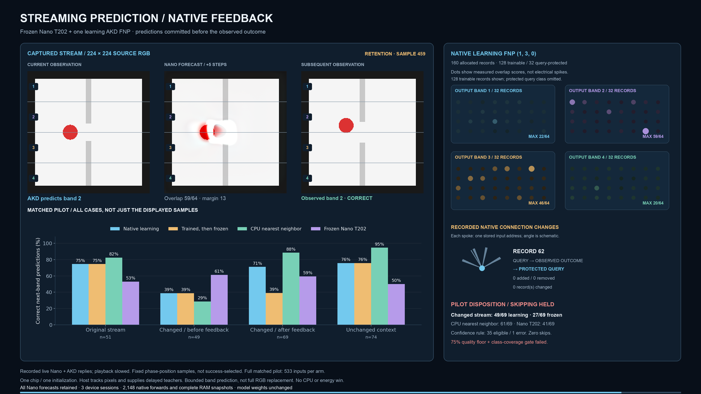

[4K60 MP4](https://raw.githubusercontent.com/MidasMulli/akd1500-lab/main/visual/streaming-prediction-4k60.mp4) ·
[tools and scope](streaming/README.md) ·
[assessment](studies/20261024-streaming-prediction/ASSESSMENT.md) ·
[next gates](streaming/NEXT.md)

## Native execution: causal NPU checks and blocked-host learning — October 24, 2026

**Native capability and a CPU advantage are separate questions.** Identical binary
computation runs on FNP and CNP paths with all outputs and parameter RAM checked.
The CNP detector population grows **16×** with **1.39× DMA buffer-service cost**
(128→2,048 outputs, half-active inputs). Eleven separate parameter interventions
produce their exact predicted output changes across all 11 compute CNP regions.

Separately, 32 queued native learning events complete while the host worker
sleeps, with no driver polling. Captured state and outputs match the polling
control. **CPU remains faster on the matched fixed task**: about 9.20 µs versus
86.96 µs/input at 2,048 detectors through the measured native serial host path.
No calibrated energy advantage is established.

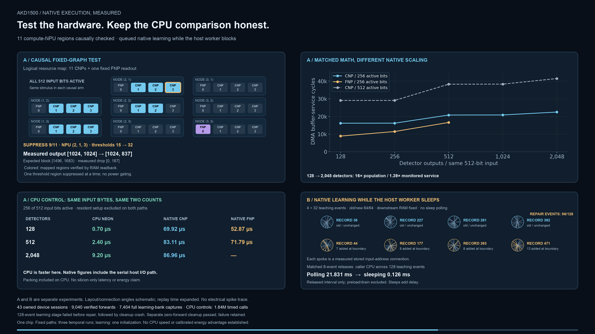

[4K60 MP4](https://raw.githubusercontent.com/MidasMulli/akd1500-lab/main/visual/native-primitives-4k60.mp4) ·
[tools and scope](capability/README.md) ·
[primary assessment](studies/20261024-native-primitives/ASSESSMENT.md) ·
[causal checks](studies/20261024-cnp-contribution/ASSESSMENT.md) ·
[next discriminators](capability/NEXT.md)

The 128-event learning stage fails before repair at a 129-slot request, then
crashes during cleanup. A separate zero-forward diagnostic measures the runtime's
128-slot clamp and cleanly unprograms the owned graph. The failed prefix, source
lifetime hazard, exact executed source and hardened publication are preserved.
Across all three studies: **43 owned sessions, 9,040 verified forwards and 7,404
complete learning-bank captures**. Fixed paths have three temporal runs; quiet
learning has one initialization and one run per qualified arm.

```bash
python -m capability.archive audit-public
python -m capability.contribution_archive audit-public
```

## Three native memories: repair one, preserve the others — October 23, 2026

**Six resident NPUs, three connected plastic populations.** After synthetic
beacon signals change, recognition-only repair recovers **64/64 new-signal
outputs**, while retaining **64/64 old-signal outputs** in all three native
initializations. Frozen controls stay at **16/64** on changed signals.

Complete RAM shows the native rule using four additional existing recognition
records, preserving every word of the original four learned records and the
complete state of both downstream memories. There are 1,536 allocated records;
connection edits touch **8 / 4 / 4**, not the entire population.

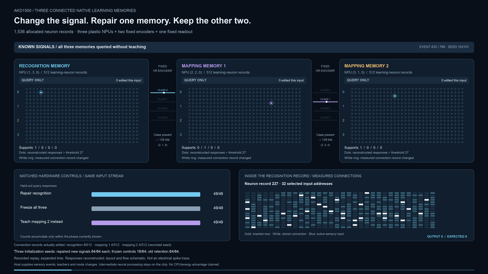

[Download 4K60 MP4](https://raw.githubusercontent.com/MidasMulli/akd1500-lab/main/visual/fnp-or-relay-4k60.mp4) ·
[assessment](studies/20261023-fnp-or-relay/ASSESSMENT.md) ·
[tools and reproduction](resident/README.md) ·
[review draft](visual/fnp-or-relay-X-DRAFT.txt)

All **6,672 forwards and 20,016 complete RAM captures** independently recount.
This is one four-class sensory world with host-supplied teachers and mode
changes. The film is a recorded replay; responses are reconstructed and layout
schematic. No CPU or energy advantage is established. This FNP-only alternative
leaves the mixed FNP-to-CNP handoff unresolved: a separate 13-session/824-forward
study characterizes its channel collapse and preserves a failed bitwidth repair.

```bash
python -m resident.or_archive audit-public
python -m resident.or_recruitment
python -m resident.contract_archive audit-public
```

## Isolated bridge: components pass, mixed handoff fails — October 23, 2026

A follow-up removes learning and custom adapters entirely. The all-FNP network
and a directly fed CNP network each pass **128/128 native patterns**. The
compiler-produced FNP→CNP network instead returns class3 for the first class0
pattern; it stops immediately. Fixed parameter RAM stays unchanged. Five owned
sessions/321 forwards narrow the representation/routing problem without claiming
its cause, a hardware maximum or a scaled-learning success.

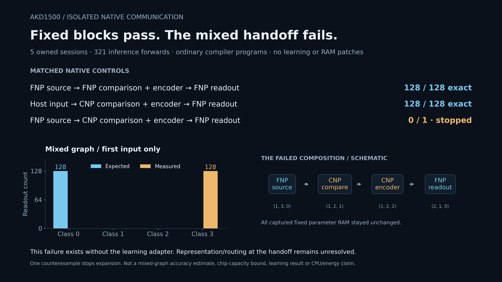

[Assessment](studies/20261023-fixed-bridge/ASSESSMENT.md) ·
[tools and current limits](resident/README.md)

```bash
python -m resident.bridge_audit
```

## Resident learning scale-up: compiler pass, native state stop — October 23, 2026

The new mixed FNP3/CNP graph maps **six learning banks on 17 NPUs**, but its
intermediate-learning adapter fails the two-bank memory gate. The larger native
stages were not admitted. **Six owned sessions, 663 actual forwards and 796 full
bank captures** preserve three one-bank passes and all three failed adapter
attempts. The earlier verified two-bank FNP-only result remains separate.

A bounded two-bank image partition also fails SDK IP-version compatibility before
hardware access. Neither branch establishes a new CPU or energy advantage.
The proposed stronger demo/post gate did not pass; the tools retain that outcome.


[Tools and reproduction](resident/README.md) ·
[assessment](studies/20261023-resident-push/ASSESSMENT.md) ·
[next isolated contract gates](resident/NEXT.md)

```bash
python -m resident.archive audit-public
```

## Real images: quality passes, native mapping stops — October 23, 2026

A 3,200-exemplar MNIST benchmark reaches **91% raw / 90% spatially compacted**
on a fresh balanced 1,000-image test. The failed 480-exemplar parent remains
preserved. Both larger native graphs then fail the compiler's **2,048 filters
per layer** ceiling. This is an interface rejection, not measured chip capacity;
**zero hardware sessions** were admitted.

Three actual CPU implementations agree exactly over **18,000 timed
classifications**. The compacted NEON nearest-neighbor hot path takes about
**20.5µs median**, including input pooling, packing and class selection. That is
the concrete target for a future verified native partitioned-bank design.
There is no new AKD timing, learning or energy result here.

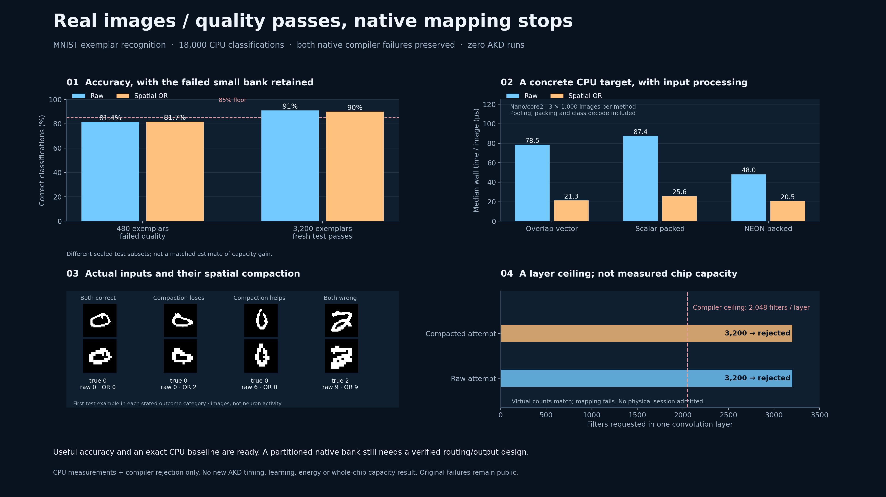

[Tools and reproduction](recognition/README.md) ·
[assessment](studies/20261023-image-capacity/ASSESSMENT.md) ·
[preserved small-bank failure](studies/20261023-image-compaction/ASSESSMENT.md) ·
[next native design gates](recognition/NEXT.md)

```bash
python -m recognition.archive audit-public
```

## A native graph rewrite, with measured limits — October 23, 2026

**16 physical sessions, 2,624 forwards, exact outputs and fixed parameter RAM.**
An extra native encoder NPU reduces redundant 512-input detector records to 128
inputs while keeping host I/O identical. With 512 detectors, half-active DMA
service falls 5.92% and captured parameter payload falls 34.86%. Three temporal
repeats reproduce the cycle medians. At 256 detectors the extra stage loses;
fully active 512-detector inputs also lose. Eight queued **zero-activity** inputs
show 21.05% less monitor service, with preload/drain excluded.

This is a supported native graph rewrite on a synthetic four-copy input domain,
not a new internal learning algorithm. CPU-only teaching-policy candidates failed
quality/resource gates and were not admitted to physical learning. No CPU or
calibrated energy advantage is established.

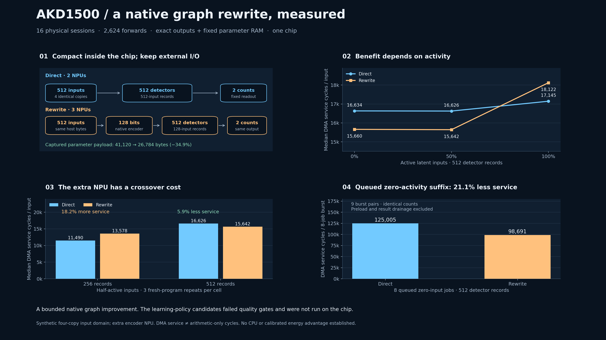

[Tools, boundaries and reproduction](kernel/README.md) ·
[native assessment](studies/20261023-native-compaction/ASSESSMENT.md) ·
[programmability map](kernel/PROGRAMMABILITY.md) ·
[failed learning-policy validation](studies/20261023-native-policy-validation/ASSESSMENT.md)

```bash
python -m kernel.experiment audit-public
python -m kernel.report
```

## Sparse-work and coupled-learning limits — October 23, 2026

**Two follow-up studies: 70 physical sessions, 19,712 forwards and 27,136 complete
bank-state captures.** All outputs, recorded learning states and counter controls
pass independent numerical reconstruction.

* At fixed input size and population width, changing selected connections from
  8 to 64 barely changes initial-query service cost. Increasing input dimensions
  does. The tested FNP3 path is consistent with full-record scanning; sparse
  connections do not establish sparse-query acceleration.
* In a five-NPU resident graph, both learning banks make connection edits in the
  same input job. Across three seeds, each bank's entire captured state trajectory
  matches its solo-learning control. Fixed communication/readout memory stays
  unchanged. The common teacher and feed-forward dependency remain explicit.
* A compiled CPU control reproduces every output and both final learning states,
  using about 5.07 µs per event when both banks learn. Native transport/fetch waits,
  unmatched whole-host costs and absent calibrated power prevent a substrate
  efficiency claim. Same-job edits do not prove physical update overlap.

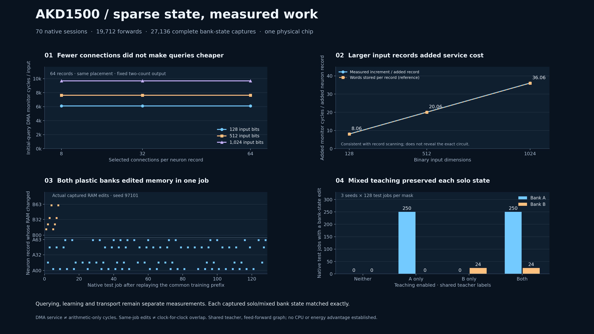

[Sparse-work assessment](studies/20261023-sparse-work/ASSESSMENT.md) ·
[coupled-learning assessment](studies/20261023-learning-interference/ASSESSMENT.md) ·
[CPU control protocol](studies/20261023-coupled-cpu/PROTOCOL.md) ·
[numerical chart data](visual/execution-limits-data.csv) ·
[remaining hardware questions](metal/NEXT.md)

Hardware-free recounts:

```bash
python -m metal.sparse audit-public
python -m metal.interference audit-public
python -m metal.cpu_compare audit-public
```

## Earlier native execution and causal NPU checks — October 23, 2026

**28 physical sessions, 9,824 forwards, exact numerical checks.** A hardware
counter study separates neuron-population scaling, activation sensitivity,
multi-NPU partitioning and teaching queue behavior. A separate causal ablation
reads actual weight/threshold/readout memory from all three NPUs and suppresses
each compute group's thresholds in turn: only that group's output disappears.

At half-active inputs, 128 fixed convolution outputs on one compute NPU use
16,213 median DMA-monitor cycles; 256 outputs on two use 16,223.5. In the tested
FNP3 path, more neuron records instead add approximately 20 monitor cycles each.
Eight-input teaching bursts reproduce exact outputs and RAM with both the
normal setting and a bounded direct pipeline-flag test. These distinguish
resource behavior; they do not establish per-neuron clock timing or a CPU/energy
advantage.

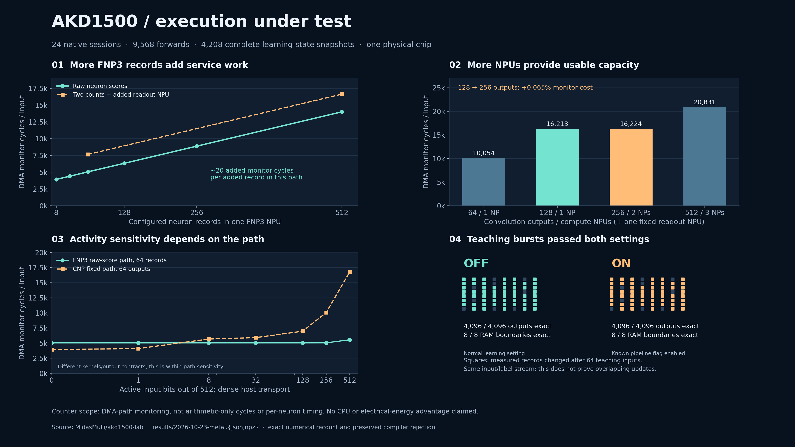

[Methods and open questions](metal/README.md) ·
[execution assessment](studies/20261023-metal-characterization/ASSESSMENT.md) ·
[causal ablation](studies/20261023-metal-ablation/ASSESSMENT.md) ·
[public recount](metal/audit_public.py)

## Two resident learning memories, selectively repaired — October 23, 2026

**Recognition can adapt while a connected routing memory keeps its rule.**
This synthetic sensor-routing task uses five native NPUs: two independently
taught 64-neuron learning banks, a fixed native comparator and categorical
encoder between them, and a fixed four-count output. All intermediate neural
processing stays in one resident hardware pass.

After beacon signatures change, recognition-only repair recovers **64/64**
correct destinations while preserving **64/64** old-signature responses.
Routing's complete captured learning RAM stays unchanged. Frozen and routing-
only repair each reach **16/64** on changed signatures; routing-only repair
also reduces old-signature performance to **48/64**. All three initializations
reproduce these outcomes on one chip and one synthetic sensor world.

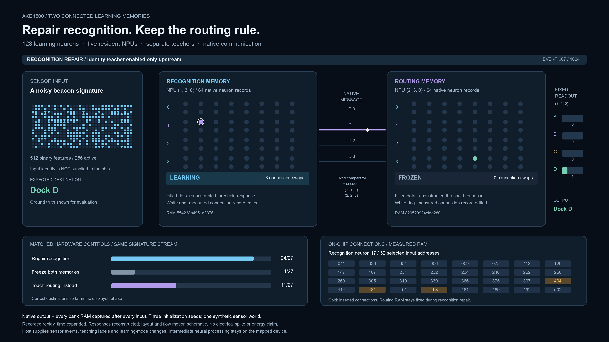

[Download 4K60 MP4](https://raw.githubusercontent.com/MidasMulli/akd1500-lab/main/visual/signal-relay-4k60.mp4),
[tools and explanation](relay/README.md),
[assessment](studies/20261023-signal-relay/ASSESSMENT.md),
[results](results/2026-10-23-signal-relay.json).

Every one of **9,280 native forwards** and **18,560 complete learning-bank
snapshots** passes independent reconstruction. The host supplies different
teachers and schedules which bank learns; this is not autonomous teacher
selection, simultaneous independent streams or recurrent planning. A simple
CPU comparator also solves the task. **No CPU speed or energy advantage is
established.** The 24-second film is a time-expanded recorded replay: RAM edits
and final counts are measured; intermediate responses and flow are reconstructed
or schematic. Sources and numerical archives are public; generated vendor
programs and runtime remain external.

## Native relearning and a direct CPU cost comparison — October 23, 2026

**The current Pong pipeline does not establish a neuromorphic advantage.**
After identical new-rule teaching, an AKD learner without old court-A labels
scores **46/64**, an old-A learner adapting to the new rule scores **28/64**,
and trained-then-frozen scores **12/64**. The practical CPU recent-neighbour
learner scores **44/64**. All three native arms retain **47/64** on court B
without further B teaching. This is one physical initialization; no native
accuracy advantage over CPU is established by the two-example difference.

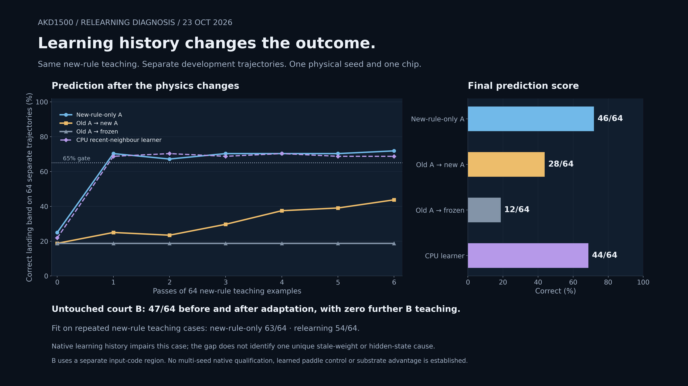

The fresh A arm fits its repeated teaching cases at 63/64, while relearning
reaches 54/64. Prior learning history impairs this case; the physical cause is
not uniquely isolated. Both prospectively fixed connection-count repairs fail
their exact-rule CPU screens, so native seed expansion, confirmation and paddle
control stay closed. Forecasts are labeled separately from native results.

**The same recorded neural task is also cheaper on the CPU in every tested
transport configuration.** Exact CPU replay uses about **11.2 µs/input**.
Serial MMIO costs **342.6 µs/input** and **342.3 µs/input** of caller CPU.
A targeted queued read-only DMA path reduces caller CPU to **54.7 µs/input**
and elapsed cost to **256.0 µs/input**, averaged over three repeats. This is an
84% reduction in caller CPU versus our MMIO path, while exact CPU replay still
uses less. Queued elapsed/input is batch-amortized cost, not event latency.

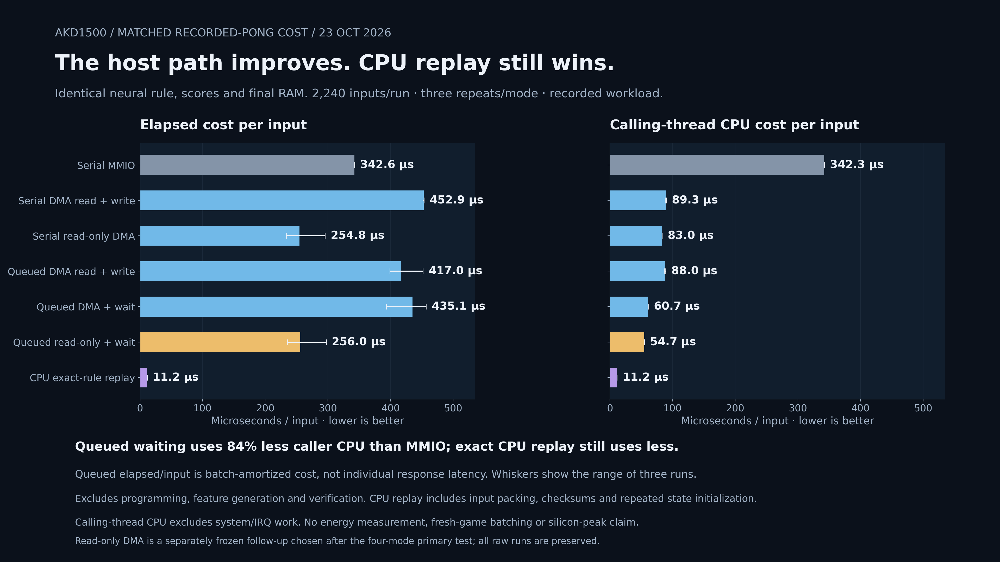

[Tools and reproduction](pong/relearn/README.md),
[learning assessment](studies/20261023-pong-relearning/ASSESSMENT.md),
[primary cost assessment](studies/20261023-pong-substrate/ASSESSMENT.md),
[read-only DMA follow-up](studies/20261023-pong-read-dma/ASSESSMENT.md).
The primary four modes were frozen before execution; the read-only follow-up
was separately frozen after reviewing their input/submit/fetch breakdown.
All **47,072 new native forwards** pass independent checks: 6,752 have complete
per-step RAM captures; the 40,320 transport replays have every score and full
final RAM bound to the original physical stream. No installed driver or runtime
was changed. These are current program/host-path costs, not silicon-only or
electrical energy measurements, and do not establish chip-peak capability.

## Changing-physics Pong with a trained-then-frozen control — October 23, 2026

**Native learning responds to the changed rule, but useful prediction remains
unqualified.** Both arms first replayed the same 512 labeled presentations and
reached identical complete trained RAM and scores. After court A's physics
changed, the continuing learner predicted the correct landing band on **12/48**
separate development trajectories; the trained-then-frozen arm scored **4/48**.
The evaluation-only best constant scored **19/48**. The preset 65% accuracy gate
failed, so additional seeds, confirmation trajectories and learned paddle
control stayed closed.

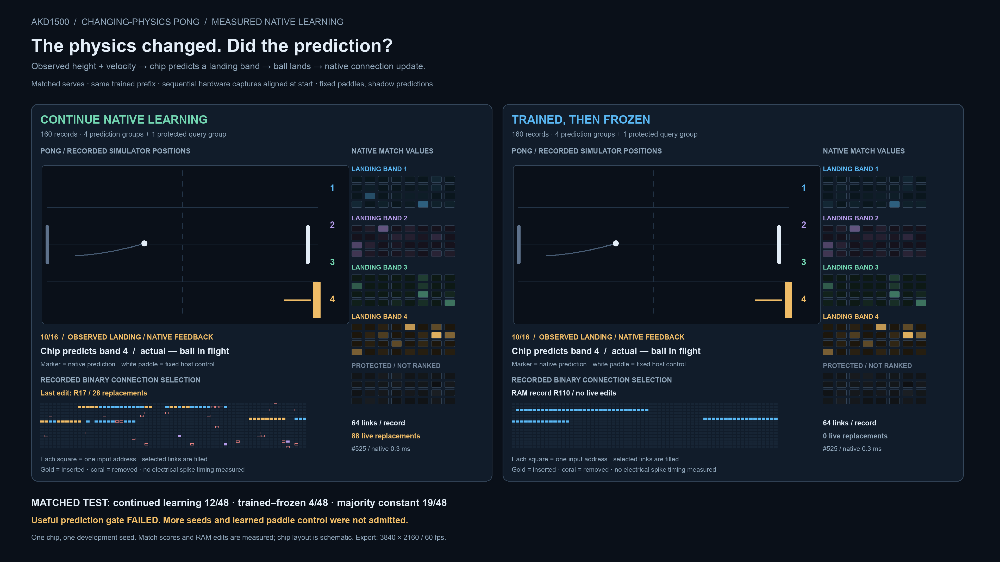

[Download 4K60 MP4](https://raw.githubusercontent.com/MidasMulli/akd1500-lab/main/visual/pong-physics-4k60.mp4),
[results](results/2026-10-23-pong-physics.json),
[assessment](studies/20261023-pong-physics/ASSESSMENT.md),
[tools and reproduction](pong/README.md).

The 23-second film captures 16 wall-paced serves per arm, sequentially aligned
at their starts. Paddles remain fixed; the colored landing marker is the actual
native prediction. Teaching follows the observed landing. All 160 integer
match values and actual connection edits are traceable to the public raw
archive: **4,140 physical forwards and complete per-forward RAM checks**.
The filmed learner made 174 native connection replacements; its frozen control
made zero after their shared training. The host supplies the simulator,
position/velocity encoding and four-band decoder. No pixel-learning, electrical
spike, full-chip, energy or useful Pong-control claim follows from this result.

## Continuous Mario decisions with matched frozen controls — October 23, 2026

**The native loop now chooses again every 24 game frames and learns from each
executed action. Its first matched pair regressed, so expansion stopped.**
Across four development starts, the learned arm advanced 1,418 pixels versus
frozen 1,554. Frozen suppresses both preparation and online learning; this
comparison does not isolate online updates after shared training. All eight
episodes ended in death; neither arm completed a level.
The predeclared regression gate closed new seeds and left confirmation starts
unopened. This is a functioning continuous interface, not a learning advantage.

One resident bank made 46 learned and 69 frozen decisions, with **507 native
connection replacements online** in the learned arm and zero RAM changes in
frozen. All 3,385 forwards, complete per-step RAM, rendered frames, input
features and action/outcome bindings passed independent verification. Game
resets occur only between labeled episodes; neural state stays resident across
the four episodes. Short actions, RGB/time features, ranking and teaching labels
are host supplied. The chip learns associations natively.

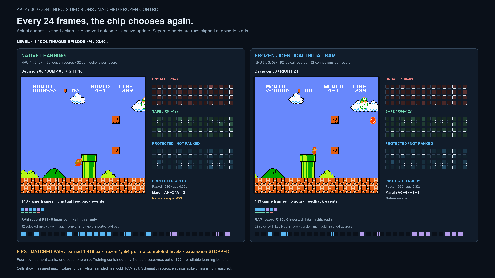

[Download paired 4K60 MP4](https://raw.githubusercontent.com/MidasMulli/akd1500-lab/main/visual/mario-continuous-4k60.mp4),
[results](results/2026-10-23-mario-continuous.json),
[assessment](studies/20261023-mario-continuous/ASSESSMENT.md),
[tools and reproduction](mario/continuous/README.md).
The separate physical runs are aligned at each episode start. A darkened view
means that arm died while its counterpart continues; later-episode responses
are never displayed on the ended game. Cell brightness is a measured match
response, not an electrical spike trace. Training had only 4 unsafe outcomes
out of 192, limiting hazard coverage. A new data/representation development
stage is needed before another qualification attempt.

## Larger sealed Mario test and live chip capture — October 23, 2026

**Learning did not pass the larger confirmation gate.** Five matched physical
learned/frozen pairs on 128 prospectively fixed encounter timings scored
**551/640 learned versus 534/640 frozen**. Learning won four pairs, but the
2.66 percentage-point gain missed the preset 5-point threshold. On the 25
contexts where the action matters, the conditional gain was 13.6 points and
its block-bootstrap 95% interval was **−2.86 to +25.6 points**, including zero.
The best constant action scored **555/640**. These are repeated initializations
on the same bank and one chip, not 640 independent environments.

Every native response and captured RAM state passed the independent Python
reconstruction. All 1,280 learned/frozen selected-action outcomes also matched
fresh emulator executions. Earlier failed development gates remain failed;
this separate confirmation was registered before collecting its test outcomes.
No representation or training change was made in response to those outcomes.

**The video contains actual hardware responses alongside wall-paced gameplay.**
It preserves the measured timing: about 56 captured game frames/s and 8.4 pairs
of chip queries/s. It shows 45 native connection replacements after four actual
outcomes. Those clips use selected development cases; the table shows the
separate sealed confirmation. Colored cells display measured match responses,
not electrical spike traces. The host still supplies RGB/time features, ranking
and two fixed 90-frame actions; shadow queries do not replan the action.

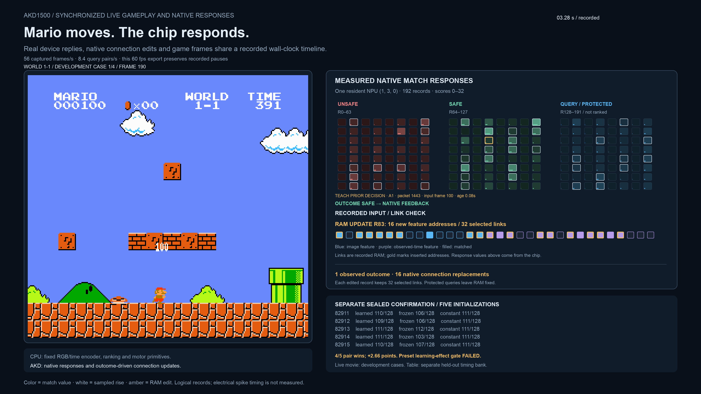

[Download 4K60 MP4](https://raw.githubusercontent.com/MidasMulli/akd1500-lab/main/visual/mario-live-responses-4k60.mp4),
[confirmation results](results/2026-10-23-mario-confirmation.json),
[protocol and assessment](studies/20261023-mario-confirmation/ASSESSMENT.md),
[tools and reproduction](mario/sealed/README.md).
The public archives include all 25,406 native forwards from this extension,
their inputs, labels, outputs and per-step RAM; no ROM or vendor runtime.
This establishes working native learning and instrumentation, while a reliable
Mario advantage and CPU/energy advantage remain unproven.

## Recovery and a first Mario skill screen — October 23, 2026

**The image service now tests whether a failed route has recovered.** A supplied,
bounded probe clock requests exploration; the native circuit chooses the action
and updates its consequence memory from the actual worker result. In three fixed
encodings on one chip, it corrected stale decoder-failure memories by requests
13, 14 and 15. The reactive control made no recovery query during that window.
Both completed 72/72 PNGs; probing cost 156 operations versus 154. Frozen
transition-memory controls completed 53/72. Earlier knowledge is demonstrated;
more completions than the reactive control and a substrate advantage are not.

All native decisions, outputs and captured learning RAM passed independent raw
recounts. The identical CPU algorithm reproduced every action and outcome.
The missing-FlatBuffers build failure and an unaligned-access transport failure
remain preserved. The repair used a fresh namespace and left neural programs
byte-identical. No installed driver, runtime or firmware was changed.

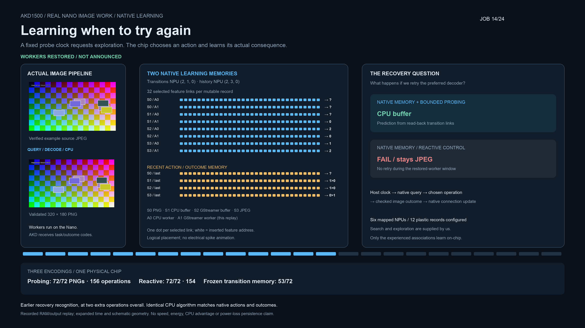

[4K60 recovery replay](visual/recovery-replay-4k60.mp4),
[results](results/2026-10-23-recovery.json),
[protocol and assessment](studies/20261023-recovery-r1/ASSESSMENT.md),
[reproduction](image_service/README.md). Link slots and placement are schematic;
connection contents come from measured RAM. The example JPEG is our test fixture.

**The first Mario test is mixed.** A 96-record native association bank received
authored binary features from two rendered frames plus a candidate action.
After four fixed epochs of 12 labeled experiences, each initialization selected successful
actions at 7/8 nearby held-out starts. Frozen controls scored 6/8, 8/8 and 6/8;
action-only controls scored 5/8 each. Learned totals were 21/24 versus frozen
20/24 and best constant 18/24. The predeclared two-of-three screen passed, but
this tiny aggregate gain and the stronger frozen seed prevent a robust learning
claim. All 72 selected-action trials matched in fresh emulator episodes.

The host supplies the visual encoder, ranking and two 90-frame motor primitives.
The chip changes selected binary connections natively. This is recorded-experience
consequence learning followed by fresh action execution, not full-game RL,
learned perception, frame-by-frame native control or transfer to unseen levels.
Every score and full RAM snapshot matched the C++ and independent Python models;
queries left visible RAM unchanged. Hidden-selector or power-loss durability
does not follow.

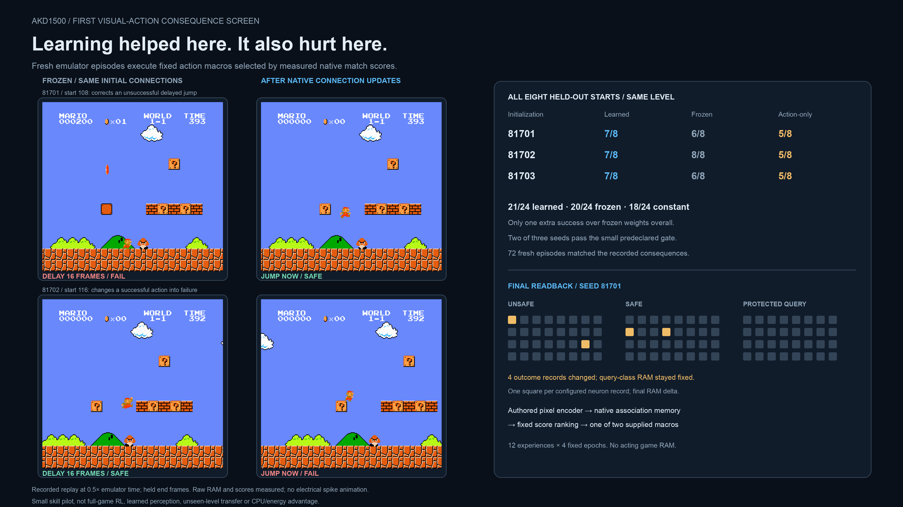

[4K60 comparison](visual/mario-consequence-4k60.mp4),
[results and limitations](results/2026-10-23-mario.json),
[public raw scores/RAM](results/2026-10-23-mario.npz),
[fresh episode receipts](results/2026-10-23-mario-fresh.json),
[protocol and reproduction](mario/README.md).
Hardware-free tests reconstruct all 752 native inputs and reject forged matching
CPU/native scores and query-state edits. The next useful gate is a larger,
prospectively sealed encounter bank with enough independent variation to resolve
the frozen-control result; do not tune this test after seeing its outcomes.

## Connected learning and host offload — October 23, 2026

**Three connected native learning banks passed exact physical checks.** Each
has 64 configured neurons, 512 binary inputs and 32 selected connections per
neuron. Two fixed encoders and a fixed two-count readout bring the graph to six
FNP3 placements. Every stage receives the same external class label; updates
are local native feature/connection selection, not backpropagation.

We checked the full RAM of every bank after every input, final output counts,
and fixed encoder/readout memory. Three seeds passed. Freezing the middle bank
kept its complete RAM fixed while both neighbors continued learning; freezing
all banks prevented every connection edit. Intermediate neuron responses in
the replay are reconstructed from the exact reference; RAM edits and final
counts are measured.

A first positive-only fanout saturated all 64 final-bank responses in 135 of
192 confirmation inputs. A fixed balanced code—four response copies and four
complement copies—reduced that to 0/192 on the same seeds and input streams.
This repairs a representation problem; it is not task-generalization evidence.

The proposed larger CNP-interleaved family failed physical reference checks,
including its untouched compiler inference graph. We stopped that family and
retained all ten failed/diagnostic attempts, including one invalid pre-device
invocation and three host cleanup crashes. The cleanup buffer-lifetime bug was
fixed. No four- or seven-bank physical success is claimed.

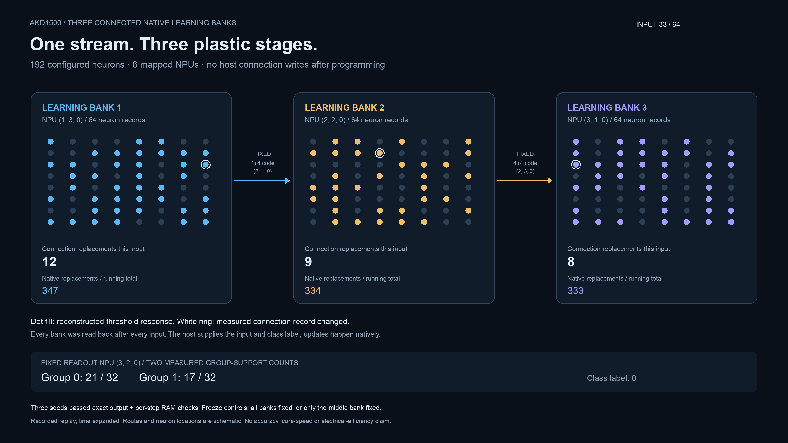

[4K60 recorded replay](visual/network-replay-4k60.mp4),
[balanced-bank results](results/2026-10-23-balanced-network.json),
[per-input RAM and outputs](results/2026-10-23-balanced-network.npz),
[earlier branch and preserved failures](results/2026-10-23-network.json),
[balanced protocol](studies/20261023-balanced-network/PROTOCOL.md).
The routes, neuron positions and motion are schematic, with time expanded.

The host-offload experiment also passed matched-output/RAM checks:

| Same output within each pair | Host transaction, µs/input | Calling-thread CPU, µs/input |
|---|---:|---:|
| 512 scores / MMIO | 961.48 | 960.43 |
| 512 scores / kernel DMA read | 951.65 | 104.56 |
| Two counts / queued busy polling | 69.25 | 69.14 |
| Two counts / queued 50 µs sleeps | 79.79 | 29.12 |

Medians of three interleaved run means. DMA reduced calling-thread CPU about
9.2 times at similar full-score latency. Queued sleeps reduced caller CPU
about 2.4 times, with about 15% more latency. The initial small DMA smoke was
much slower and remains preserved; its cause is unresolved. Caller CPU is not
whole-system CPU/IRQ accounting. **No electrical-energy advantage is established.**
Two sparse-input metadata adapters timed out and are preserved. The available
driver source has DMA-transfer completion interrupts; this does not establish
an exposed inference-completion interrupt. Exact loaded-module source identity
is unverified. No installed driver/SDK was changed.

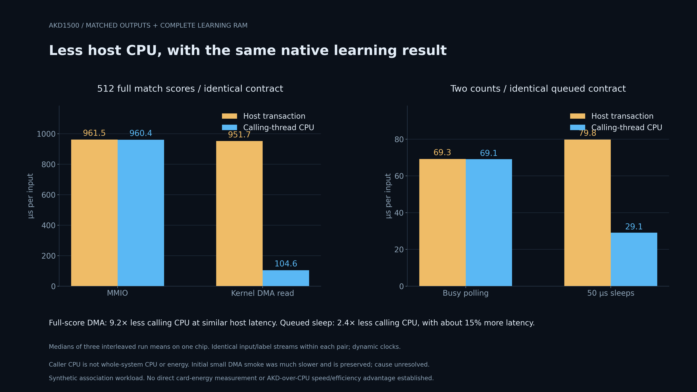

[Offload results and failures](results/2026-10-23-offload.json),
[raw outputs, RAM and timing](results/2026-10-23-offload.npz),
[protocol](studies/20261023-host-offload/PROTOCOL.md).

The shorter wait was separately applied to the existing **two-memory image
service**, which processes pixels on the Nano and sends compact job outcomes
to the AKD. Both wait paths completed 24/24 real image jobs through owned worker
outages, with identical actions/outcomes and every neural-memory snapshot.
The CPU controller matched every decision/outcome too. Removing the previous
deliberate 20 ms guard is an interface change, not a silicon-compute speedup.
The new three-bank synthetic cascade is not yet this application controller.
[Image-service evidence](results/2026-10-23-image-offload.json),
[packaged image-service tooling](image_service/README.md).

Hardware-free tests reconstruct all published passing offload and network
streams and reject corrupted output/RAM even when their file hashes are
updated. The remaining electrical gate is an assembled, calibrated direct
card-power rig; module rail readings cannot replace it.

## Compact-output follow-up — October 23, 2026

**28 additional physical sessions passed, covering 5,056 native inputs.** The
first stage compared full potentials with threshold responses. After exact
verification, the second added a fixed downstream NPU that sums each of two
groups of 256 threshold responses. The 512-neuron bank still learns natively.

| Output contract | Payload bytes/input | Matched CPU, µs/input | Native + host, µs/input |
|---|---:|---:|---:|
| 512 integer match scores | 2,048 | 16.52 | 961.88 |
| 512 responses above threshold seven | 512 | 16.65 | 287.64 |
| Two group-support counts | 8 | 17.56 | 73.70 |

These are medians of three paired run means. Returning two counts reduced the
measured native host transaction time about 13 times relative to full scores.
**The contracts carry different information:** thresholds discard magnitudes;
counts also discard neuron identity. This is not a speedup at the full-score
contract, nor a classification-accuracy result. One-bit dense responses occupy
one byte per neuron on this transport. Payload excludes headers, input traffic,
descriptors and polling.

Every response/count and the full learning state matched an independent Python
selector model. All final learned connection/adaptive-threshold words agree across
contracts; the mask and downstream-reducer versions also have exactly identical
complete final learner RAM (10,242 words). The fixed downstream sum is programmed by
us. This two-NPU experiment is separate from the 32-NPU routing-coverage study.

Batching eight jobs did not materially improve the mask transaction in this
screen. An inference-only early-exit CPU variant was also tested; it did not
beat the regular CPU control in that single probe. The CPU remains faster in
the confirmed matched learning comparisons. **No electrical efficiency
advantage has been established.** Host busy polling remains part of the path.

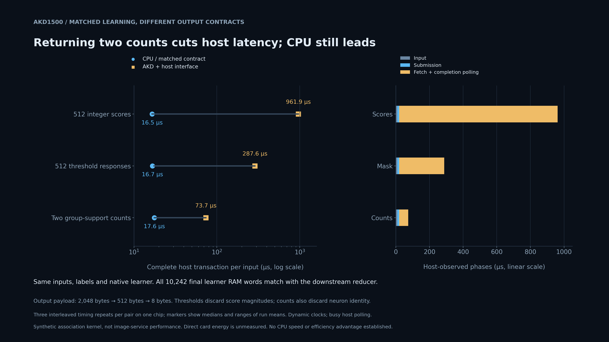

[Verified results](results/2026-10-23-readout.json),
[raw outputs, learning RAM and timings](results/2026-10-23-readout.npz),
[4K60 paired recorded replay](visual/readout-replay-4k60.mp4),
[threshold-output protocol](studies/20261023-compact-readout/PROTOCOL.md),
[downstream-reducer protocol](studies/20261023-class-reduction/PROTOCOL.md).
The replay pairs separate matched native executions; it is not live wire tracing.

## First measured study — October 23, 2026

**22 passing physical sessions and two preserved failed burst attempts on one
chip.** The failures exposed a withheld full-ring queue-publication problem;
leaving a spare descriptor slot restored repeated-burst execution.

The 32-NPU mesh passed twice. Its evidence run contains 64 observations,
4,096 exact output scores and 64 per-step learning-RAM readbacks. In that run,
54 of 64 learner records changed, with 1,004 connection replacements.
This is routing/learning integrity, not peak utilization or a useful CNN task.

| Kernel | CPU reference, µs/input | Native + host interface, µs/input |
|---|---:|---:|
| 128 inputs / 8 neurons | 0.46 | 43.4 |
| 512 inputs / 64 neurons | 3.39 | 152.6 |
| 512 inputs / 512 neurons | 16.53 | 961.6 |

Medians of three paired run means, each with 256 native examples and 256 CPU
repetitions of the same stream. These include native input/submission/completion/
output costs. They establish **no speed or energy advantage for the AKD** on
these workloads. Clock governor remained dynamic; this is a system-path result.
Output drain accounted for approximately 94% of the larger resident-burst
transaction. That separation is not a measurement of core-only execution time.

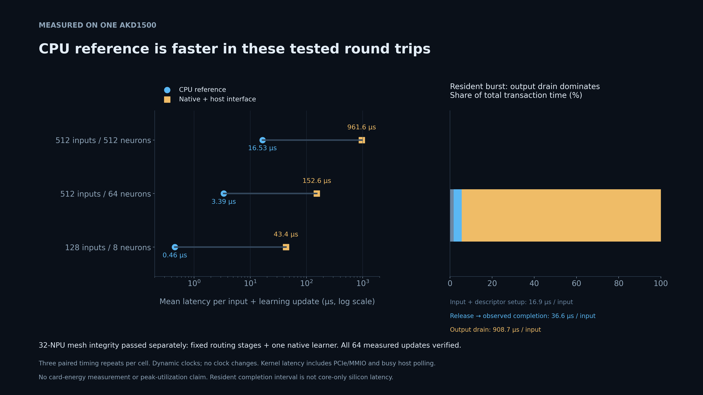

[Public results](results/2026-10-23.json), [raw mesh evidence](results/mesh32-evidence.npz),
[4K60 recorded replay](visual/mesh32-replay-4k60.mp4),
[remaining hardware gaps](ROADMAP.md). **No calibrated card-energy result yet.**

## What is here

* A bounded PCIe MMIO adapter using a separately supplied Akida runtime.
* A C++ CPU bitset learner and an independent Python integer/set verifier.
* Exact per-output and complete learning-RAM comparisons, not classifier-only checks.
* Input-width/neuron-count compiler probes that retain unsupported mappings.
* A fixed-permutation mesh ladder ending in native association learning,
  including a compiler-generated single-pass 32-NPU configuration.
* Input/submission/fetch timing and an experimental resident-burst instrument.
* Matched potential, threshold-mask and two-count output contracts with a
  guarded intermediate-learning program assembler and independent verifiers.
* INA228 recorder firmware, raw capture, calibration gates and energy analysis.
* Data-bound figures and a replay of logical placements and measured learning.

Read [the measurement protocol](studies/20261023-measurement/PROTOCOL.md),
[mesh contract](studies/20261023-measurement/MESH_PROTOCOL.md),
[resident timing boundary](studies/20261023-measurement/RESIDENT_PROTOCOL.md),
and [power-rig build plan](power/BUILD.md) before interpreting results.

## Dependencies and reproduction

Tested on Linux AArch64, Jetson Orin Nano, PCIe AKD1500 and Akida 2.19.3.
BrainChip's licensed runtime sources, SDK headers, generated program images and
device firmware are **not included**. Obtain them through the vendor's supported
distribution. No installed driver, SDK, clock or voltage settings are changed.

```bash
python -m unittest discover -s tests -v

# On the Linux machine physically hosting the card:
export AKIDA_ENGINE_ROOT=/path/to/your/runtime
export FLATBUFFERS_INCLUDE=/path/to/compatible/flatbuffers/include
bash tools/build.sh

python tools/new_study.py --name my-run --minutes 30
export AKD_LAB_STUDY=studies/my-run
python tools/prepare.py "$AKD_LAB_STUDY/fixtures"

# Start with a small, correctness-gated cell.
python tools/run_cell.py smoke "$AKD_LAB_STUDY/fixtures/n128_u8" \
  --samples 16 --cpu-repeats 128
python tools/verify.py "$AKD_LAB_STUDY"

# Compiler-only resource probe; inspect before admitting hardware work.
python tools/prepare_mesh.py "$AKD_LAB_STUDY/mesh"
```

For the compact-output instrument, build with `AKD_LAB_BENCH=readout_bench` and
generate fixtures using `tools/prepare_readout.py`. Pass
`--bench readout_bench` to `tools/run_cell.py`. Start with a 16-sample potential
and mask pair, then use `tools/verify_readout_pair.py` before expansion.
`tools/prepare_reduction.py` accepts the reviewed mask-fixture directory and a
new output directory; `tools/verify_reduction_pair.py` checks its native counts
and complete learned RAM against the matched direct-mask stream. The assembler
supports only the reviewed SDK 2.19.3 single-pass FNP3 format and rejects other
tracks or unfamiliar register differences. It does not change installed SDK,
driver or firmware files. `program_codec.py` is reused from the earlier native
image-service tooling; it is our adapter, not vendored runtime implementation.

Hardware-free CI reconstructs and independently verifies all 28 published
follow-up streams from the raw archive, and rejects deliberately corrupted
counts even when the native and C++ reference files agree with each other.
The earlier preserved failures remain in the first study's results.

The local study envelope enforces an expiry, session/forward caps, a shared
`/tmp/akd1500-research.lock`, occupied-device refusal and process cleanup.
Start a fresh explicitly invoked study when an envelope expires. These are
finite research tools, not unattended services. CPU affinity currently targets
core 2; inspect suitability for another host before running.

## Evidence boundaries

Kernel timing includes input MMIO, submission, completion polling and output
readback. Compilation, programming, reference calculations and RAM snapshots
are excluded and described separately. Busy polling is host work. Full score
readout can dominate a small PCIe workload; it is not intrinsic silicon latency.

The CPU uses population counts and the reconstructed binary learning rule,
not a deliberately slow dense neural simulator. It is an optimized reference,
not a claim of the best possible CPU implementation. The mesh uses fixed channel
permutations composed algebraically for its oracle; **that family establishes
routing integrity, not useful CNN accuracy or a hardware speed advantage**.

All 32 mapped NPUs does not mean 100% utilization, maximum memory capacity,
32 independent learners or a chip-wide learned communications protocol.
Logical placement is not a physical die floorplan. Intermediate visual motion
is explanatory replay, not electrical spike or current measurement.

The FNP3 decoder currently excludes FNP2 external-memory records. A compiler
mapping that exceeds the decoder is a tooling gap, not a measured chip limit.
Firmware, hidden learning state, restart durability, sparsity scaling, complete
FNP2 support and calibrated card/host energy remain explicit investigation areas.

The power recorder has synthetic software tests. Physical energy claims require
an assembled, calibrated sensor and complete interception of the measured supply
branch. Module power, card power and silicon-only power are different domains.

## Public evidence and development

Compact verified summaries are published under `results/`. Full raw local runs
include score vectors, learning-RAM words, timing samples, source/program hashes,
failed attempts and cleanup receipts. Local raw data and operator authorizations
are excluded from Git by default. The exporter sanitizes private paths.

Do not silently discard failed runs, call a compiler rejection a physical limit,
or claim a 10x advantage using mismatched models, accuracy, update budgets,
memory capacity, duty cycles or power boundaries.

## Sources

[Akida runtime API](https://doc.brainchipinc.com/api_reference/akida_apis.html),
[Akida engine integration](https://doc.brainchipinc.com/user_guide/engine.html),
[TI INA228 datasheet](https://www.ti.com/lit/ds/symlink/ina228.pdf),
[NVIDIA module power monitoring](https://docs.nvidia.com/jetson/archives/r36.4.4/DeveloperGuide/SD/PlatformPowerAndPerformance/JetsonOrinNanoSeriesJetsonOrinNxSeriesAndJetsonAgxOrinSeries.html).

Own tooling is MIT licensed. Vendor dependencies retain their separate licenses.
