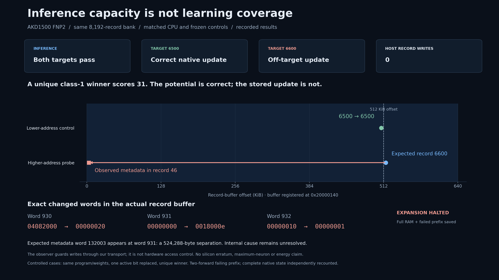

# FNP2 storage contract and a preserved off-target update failure

**Inference capacity and correct plasticity address coverage are different.**
The first FNP2 format qualification passes 144 native forwards at 544 records.
Subsequent eight-event capacity prefixes pass at 1024/2048/4096/8192 records.
At 11,264 records, frozen inference passes but teaching fails on the fourth
forward. A separate, lower-resource experiment reproduces an off-target write
in the already screened 8192-record bank. Neither failure is retried or removed.



## What was decoded and measured

The compiler's FNP2 descriptor identifies a record track stored outside the
individual NPU. Each tested 512-input record contains four metadata words and
sixteen connection words. Every initial weight bit is checked against a seeded
matrix. FNP2 readback contains no FNP3 configuration-DMA header; the CPU adapter
adds two synthetic zero words only in host reference memory.

The actual registered record address is **0x20000140**, within the known card
system-SRAM aperture. With this runtime/driver adapter, records are copied into
that allocator; "external" does not mean host DDR. At 11,264 records, the record
buffer is 901,120 bytes and runtime allocations total 991,968 bytes, approximately
95% of the exposed allocator budget. These are allocation/storage observations,
not a measurement of total chip SRAM utilization or a maximum model size.

Host-reference learning and native learning agree throughout the qualified
prefixes, including complete record state. Calling-host CPU remains faster.
For 544 records, the 64-input learning control is about 17.7 µs/input on CPU
versus 1057 µs through the monitored native serial path. Larger cells are short,
unwarmed screens; their complete timing samples remain in the public archive.
No CPU speed, electrical efficiency or useful-task gain is established.

## Controlled address test

Keep the same 8192-record program and initial weights. Select one class-1
record by presenting its connection mask with one active bit removed and one
previously absent bit added. The selected record scores 31 and is the unique
highest eligible record. Present one zero input before it; all remaining inputs
are zero. Teacher labels and mathematical endpoint are identical across cases.

| Target | Record byte offset | Frozen inference | Native teaching |
|---|---:|---|---|
| 6500 | 520,000 | All scores/state exact | Correct record updated; all eight steps exact |
| 6600 | 528,000 | All scores/state exact | Second forward changes record 46; intended record unchanged |

The failing case changes native word indices **930/931/932**. The expected
record-6600 metadata word is index **132003**; its new value instead appears at
index **931**, a difference of 131072 words / 524288 bytes. A transport wrapper
records **zero host writes to the entire record buffer**, with 12 other guarded
transport writes. Initial programming precedes guard activation.

This is an observed off-target update in the configured compiler/runtime/
hardware path. The 512-KiB metadata alias is a diagnostic clue. Several attempted
full connection-update alias models do **not** explain every changed word and
are preserved as rejected hypotheses. No silicon address-bit width, universal
neuron limit, manufacturer erratum or definitive root cause is claimed.

The 11,264-record failure selected record 8849 but changed records 2295/2296.
Its first three forwards match the independent model; the fourth potential
vector still matches but the post-update state does not. Successful low-address
updates therefore cannot qualify all addresses in a large bank.

## Scope and reproduction

Across four prospectively frozen stages: **18 physical sessions, 246 forwards,
246 complete record-state captures; two failed prefixes retained**. Sixteen CPU
streams execute 1200 samples across five fresh-state repeats. One chip and one
seeded weight family; all populations are not independently replicated studies.

```bash
python -m coprocessor.fnp2_archive audit-public
python -m unittest tests.test_fnp2_contract tests.test_record_range -v
```

The public numeric archive contains initial records, every input/potential,
all timing samples that were successfully saved, actual storage addresses,
guard counters, and losslessly reconstructed full record states with SHA256
checks. Failed processes did not save completed timing vectors; none are
invented. Sources/binaries and all partial raw files are hash-bound. Vendor
runtime sources and generated executable programs are not redistributed.

Hardware compilation requires separately licensed Akida 2.19.3 runtime sources,
compatible FlatBuffers headers and the matching static runtime library. Set
`AKIDA_ENGINE_ROOT`, `FLATBUFFERS_INCLUDE` and `AKIDA_RUNTIME_LIBRARY`, then use
`bash coprocessor/build_external.sh contract` (or `capacity`, `guard`, `boundary`).
The helper preserves the recorded compilation flags; executed source and binary
hashes are in the evidence metadata. It was packaged after the physical runs.

The four saved studies are closed. Their runners enforce authority, deadlines,
source/fixture freezes, exclusive device ownership and stage gates. Hardware
reproduction needs a new study and regenerated SDK program/fixtures, starting
with the small contract cell. Do not reopen a saved run or skip the frozen
controls to reach the failing target. The public archive supports full numeric
replay without an SDK or chip.

Next: independently review address-generation/configuration and the minimal
two-forward reproducer; isolate allocation/base, layout and compiler-version
effects under a new protocol. Do not expand high-address learning, patch the
golden reference or launch an application around this failure. Host-DDR mapping,
multi-pass operation and calibrated energy remain separate unqualified work.
