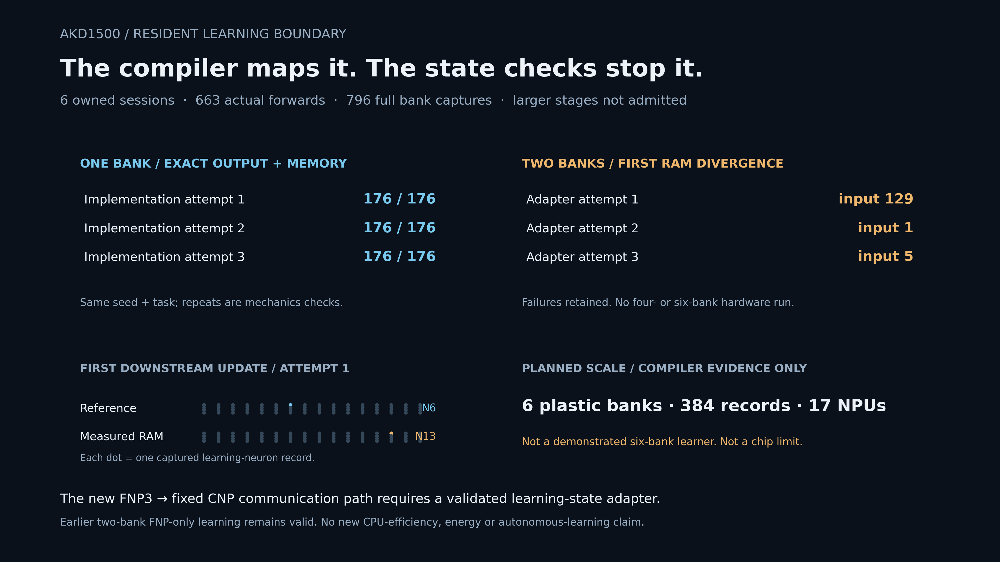

# Resident learning scale-up: a preserved interface boundary

The new mixed FNP3/CNP route **did not qualify**. It compiler-maps six learning
banks (384 records) on 17 NPUs, but two-bank learning-state checks stop expansion.
Three one-bank mechanics runs pass; three mixed-bank adapter attempts fail.
The earlier verified two-bank FNP-only study remains valid and separate.

A separate inference-only follow-up isolates the handoff: the all-FNP and
host-fed CNP controls each pass128/128 patterns, but the unmodified compiler
FNP→CNP graph fails its first pattern (expected class0, measured class3).
That diagnostic adds5 sessions/321 forwards and leaves parameter RAM unchanged.
It does not repair or qualify the larger learning graph.
[Read the isolated-bridge assessment](../studies/20261023-fixed-bridge/ASSESSMENT.md).
Recount it with `python -m resident.bridge_audit`.

Measured in this campaign: 6 owned sessions, 663 actual forwards and 796 complete
per-bank state captures. The matched repair/frozen/wrong-bank application stage
was never admitted. No new useful-task, CPU or energy advantage is established.



* [Full assessment](../studies/20261023-resident-push/ASSESSMENT.md)
* [Frozen task and stop rules](../studies/20261023-resident-push/PROTOCOL.md)
* [Next isolated contract gates](NEXT.md)
* [Numeric archive](../results/2026-10-23-resident-boundary.json)

Hardware-free verification, requiring NumPy:

```bash
python -m resident.archive audit-public
python -m unittest discover -s tests -p 'test_resident_boundary.py' -v
```

`design.py` contains the synthetic task and exact-rule reference. `prepare.py`
contains the **failed final adapter**, not a qualified native producer; it needs
a separately licensed Akida SDK. `partition.py` preserves the rejected image
partition design. `src/resident_bench.cpp` is the observed-state instrument.
`run.py` requires a new bounded authority, source freeze, stage admission and
exclusive device lock; the saved campaign is closed. Do not reopen its state.

`archive.py` checks all successful prefixes and the exact first failure in every
failed attempt, including missing-output and partial-snapshot boundaries. The
public package excludes proprietary programs/runtime sources. Optional figure
regeneration requires Matplotlib: `python -m resident.report`.
