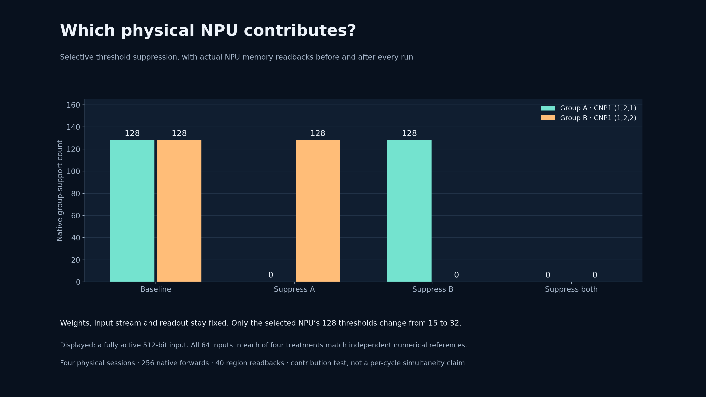

# Each of the two compute NPUs contributes causally

Four physical programs, 256 forwards, 512 native output values, and 40 initial/
final region readbacks all pass. The two CNP1 compute NPUs and fixed FNP3 readout
are physically checked through the known configuration-DMA read path.

The graph, input stream, selected connections and readout are fixed. A compiler
generated four treatments differing only in the selected threshold memory
packets. A full-program byte comparison accounts for all differences using
those packets, before physical execution. No unrelated configuration or route
change is hidden in the ablation.
The [program-difference receipt](PROGRAM_DIFFERENCES.json) records the bounded
packet substitutions and whole-program check.

| Treatment | Only changed physical target | Output on the fully active input |
|---|---|---|
| Baseline | None | `[128, 128]` |
| Suppress A | `(1,2,1)` threshold region: 128 words, 15 → 32 | `[0, 128]` |
| Suppress B | `(1,2,2)` threshold region: 128 words, 15 → 32 | `[128, 0]` |
| Suppress both | Both threshold regions | `[0, 0]` |

The displayed input is one explicit numerical boundary case. All 64 inputs per
treatment, including several activity levels, match independent integer/bitset
and matrix reconstructions. Raising a threshold to 32 suppresses its connected
32-bit patterns without changing any weight. Suppressing A preserves every B
output, and vice versa. This tests native contribution rather than merely
trusting that an NPU listed by the compiler was useful.

Both weight regions, both threshold regions and the fixed readout region are
read from their actual NPU targets before and after inference. All equal the
generated parameter packets; final contents equal initial contents. Comparing
treatments localizes the changes to the correct distinct threshold regions.
The packet destination headers are the read requests, not an independently
measured physical die coordinate system. The returned payloads and selective
behavior provide the hardware observations.

The initial preparation attempt incorrectly expected one RAM packet per NPU.
CNP weights and thresholds are separate regions, giving five packets across
three NPUs. That offline decoder-count mistake is preserved; it opened no
physical device. All four physical sessions passed without repair or retries.

This establishes separately addressable, causally contributing compute
populations in this graph. Together with the preceding service-cost scaling it
strengthens the parallel-capacity interpretation. It does not observe literal
per-cycle simultaneity, prove independent concurrent learning, establish energy
advantage, or qualify useful application performance against an optimized CPU.

The study is closed and the chip/owner lock released. Recount the public owned
numerical archive with `python -m metal.ablation audit-public`.
